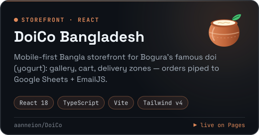
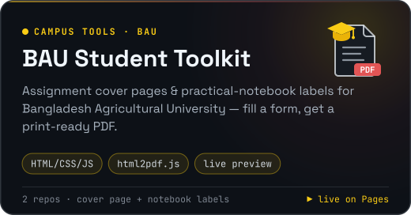
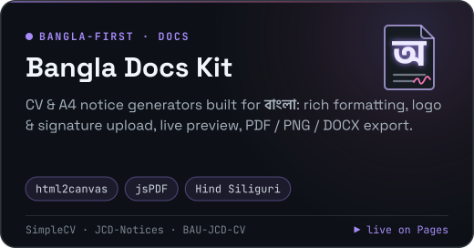

<!--
  ┌───────────────────────────────────────────────────────────────┐
  │  neion · profile README                                       │
  │  psst — you're reading the source. persist.neion.curious=true │
  └───────────────────────────────────────────────────────────────┘
-->

<!-- phones (≤600 px wide) get a stacked, large-type version of every graphic -->
<picture>
  <source media="(max-width: 600px)" srcset="https://raw.githubusercontent.com/aanneion/aanneion/main/assets/header-mobile.svg" />
  
</picture>

<p align="center">
  <a href="https://github.com/aanneion/feather_browser/releases/latest"></a>
  <a href="https://itsliar.netlify.app"></a>
  <a href="https://github.com/aanneion?tab=followers"></a>
  <a href="https://fb.com/aanNEION"></a>
</p>

## ⚡ `$ getprop | grep neion`

Hey, I'm **Neion** 👋 — an Android tinkerer from Bangladesh 🇧🇩 who likes software **small, fast and private**.
I started out compiling custom ROMs and flashing GApps. These days I build my own **Android browser in Kotlin + Jetpack Compose**, plus a bunch of **single-file web apps** that fix real, everyday problems around me: campus paperwork, Bangla documents, even party games.

## 📦 `$ pm list packages --featured`

<a href="https://github.com/aanneion/feather_browser">
  <picture>
    <source media="(max-width: 600px)" srcset="https://raw.githubusercontent.com/aanneion/aanneion/main/assets/card-feather-mobile.svg" />
    
  </picture>
</a>

<p align="center">
  <a href="https://github.com/aanneion/liargame"><picture><source media="(max-width: 600px)" srcset="https://raw.githubusercontent.com/aanneion/aanneion/main/assets/tile-liar.svg" /></picture></a>
  <a href="https://github.com/aanneion/2fagen"><picture><source media="(max-width: 600px)" srcset="https://raw.githubusercontent.com/aanneion/aanneion/main/assets/tile-2fa.svg" /></picture></a>
  <a href="https://github.com/aanneion/DoiCo"><picture><source media="(max-width: 600px)" srcset="https://raw.githubusercontent.com/aanneion/aanneion/main/assets/tile-doico.svg" /></picture></a>
  <a href="https://github.com/aanneion/BAU-Assignment-Cover-Page"><picture><source media="(max-width: 600px)" srcset="https://raw.githubusercontent.com/aanneion/aanneion/main/assets/tile-bau.svg" /></picture></a>
  <a href="https://github.com/aanneion/JCD-Notices"><picture><source media="(max-width: 600px)" srcset="https://raw.githubusercontent.com/aanneion/aanneion/main/assets/tile-bangla.svg" /></picture></a>
  <a href="https://github.com/nikgapps/config/pulls?q=is%3Apr+author%3Aaanneion"><picture><source media="(max-width: 600px)" srcset="https://raw.githubusercontent.com/aanneion/aanneion/main/assets/tile-roms.svg" /></picture></a>
</p>

<details>
<summary><b>📂 <code>pm list packages -a</code></b> &nbsp;·&nbsp; every public repo</summary>
<br/>

| package | what it does | stack | run it |
| :-- | :-- | :-- | :-- |
| [`feather_browser`](https://github.com/aanneion/feather_browser) | Ultra-lightweight, privacy-first Android browser | Kotlin · Compose · Room | [APK](https://github.com/aanneion/feather_browser/releases/latest) |
| [`liargame`](https://github.com/aanneion/liargame) | Pass-and-play party game in English & বাংলা | HTML · CSS · JS | [play](https://itsliar.netlify.app) |
| [`2fagen`](https://github.com/aanneion/2fagen) | Offline, zero-knowledge 2FA authenticator | Web Crypto · jsQR | single file |
| [`DoiCo`](https://github.com/aanneion/DoiCo) | Bangla storefront for a Bogura doi brand | React · TS · Vite · Tailwind | [visit](https://aanneion.github.io/DoiCo/) |
| [`BAU-Assignment-Cover-Page`](https://github.com/aanneion/BAU-Assignment-Cover-Page) | Assignment cover pages for BAU students | HTML · html2pdf | [try](https://aanneion.github.io/BAU-Assignment-Cover-Page/) |
| [`BAU-Practical-Notebook-Cover-Generator`](https://github.com/aanneion/BAU-Practical-Notebook-Cover-Generator) | Practical notebook labels for BAU students | HTML · html2pdf | [try](https://aanneion.github.io/BAU-Practical-Notebook-Cover-Generator/) |
| [`JCD-Notices`](https://github.com/aanneion/JCD-Notices) | A4 Bangla notice editor → PDF / PNG | HTML · html2canvas | [try](https://aanneion.github.io/JCD-Notices/) |
| [`BAU-JCD-CV`](https://github.com/aanneion/BAU-JCD-CV) | Organizational CV generator → PDF / DOCX | html2canvas · jsPDF | [try](https://aanneion.github.io/BAU-JCD-CV/) |
| [`SimpleCV`](https://github.com/aanneion/SimpleCV) | Minimal Bangla CV maker → PDF | HTML · jsPDF | single file |
| [`ClintBrowser`](https://github.com/aanneion/ClintBrowser) *(fork)* | Hacking on a lightweight browser: per-profile web identities, CI-signed builds | Kotlin | — |

</details>

<details>
<summary><b>📜 <code>cat CHANGELOG.md</code></b> &nbsp;·&nbsp; how I got here</summary>
<br/>

```diff
@@ 2026 · the shipping era @@
+ feather_browser    kotlin + compose browser, CI-signed APK releases
+ liargame           bilingual party game, live on netlify
+ 2fagen             offline AES-256-GCM authenticator
+ DoiCo              react storefront for a bogura doi brand
+ campus + bangla    cover pages, notebook labels, CVs & notices → PDF

@@ 2022 · the rom-cooking era @@
+ compiled PixelOS · AwakenOS · YAAP for r5x & spes
+ NikGapps configs merged upstream
+ Magisk + GApps on WSA experiments

@@ 2021 · init @@
+ git init neion
```

</details>

<details>
<summary><b>📊 <code>cat /proc/neion/stats</code></b> &nbsp;·&nbsp; numbers + the snake</summary>
<br/>

<p align="center">
  
  
</p>

<picture>
  <source media="(prefers-color-scheme: dark)" srcset="https://raw.githubusercontent.com/aanneion/aanneion/output/snake-dark.svg" />
  <source media="(prefers-color-scheme: light)" srcset="https://raw.githubusercontent.com/aanneion/aanneion/output/snake-light.svg" />
  
</picture>

</details>

## 🧰 `$ dumpsys toolbox`

<p align="center">
  <picture>
    <source media="(max-width: 600px)" srcset="https://skillicons.dev/icons?i=kotlin%2Candroidstudio%2Cgradle%2Csqlite%2Chtml%2Ccss%2Cjs%2Cts%2Creact%2Cvite%2Ctailwind%2Cgit%2Cgithub%2Cgithubactions%2Cnetlify%2Ccloudflare%2Clinux%2Cbash%2Cwindows%2Cvscode&perline=5" />
    
  </picture>
</p>

## 📡 `$ adb connect neion`

Found a bug in Feather? Got a word pack for LIAR, or an idea for a Bangla tool? Open an issue, send a PR, or just say hi 👋

<p align="left">
  <a href="https://fb.com/aanNEION"></a>
  <a href="https://github.com/aanneion/feather_browser/issues/new"></a>
  <a href="https://github.com/aanneion/liargame/issues/new"></a>
</p>

<br/>

<picture>
  <source media="(max-width: 600px)" srcset="https://raw.githubusercontent.com/aanneion/aanneion/main/assets/footer-mobile.svg" />
  
</picture>

<p align="center">
  
</p>